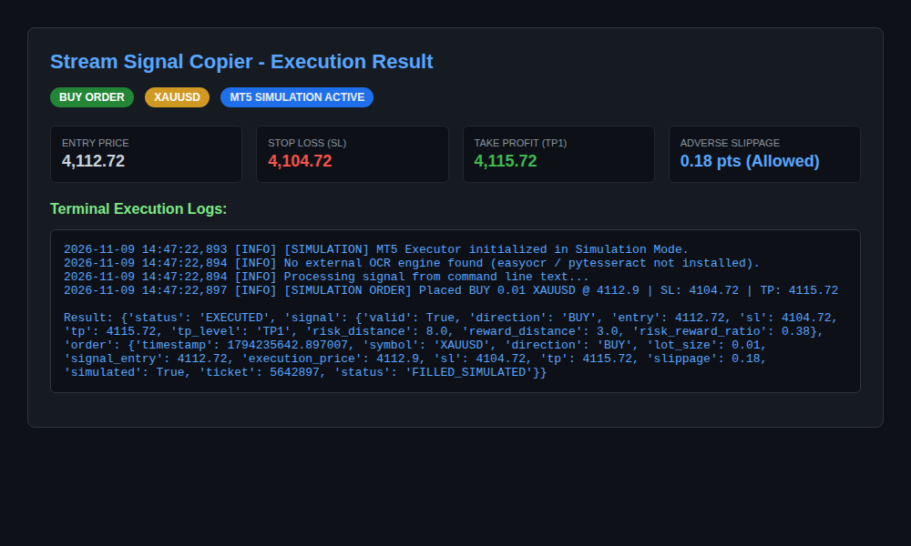

# YouTube Live Stream Signal Copier (XAUUSD -> MetaTrader 5)

An end-to-end automated signal monitor and trade copier designed to capture TradingView charts from YouTube livestreams, extract trade setups (`Entry`, `SL`, `TP1`, `TP2`, `TP3`) via OCR or text parsing, infer order direction (BUY vs. SELL), and execute trades on a MetaTrader 5 (MT5) demo account with adverse slippage protection.

---

## Execution Screenshot

Below is the verified execution demo showing signal extraction and simulated MT5 order execution:



---

## System Architecture

```text
┌─────────────────────────────────┐
│ YouTube Live Stream Chart Feed  │
│ (e.g. XAUUSD Live Trading View) │
└───────────────┬─────────────────┘
                │
                ▼
┌─────────────────────────────────┐
│      Screen Capture & OCR       │
│  (PIL / mss + EasyOCR / Tesseract)│
└───────────────┬─────────────────┘
                │
                ▼
┌─────────────────────────────────┐
│     Signal Parser & Engine      │
│  - Parses Entry, SL, TP1..TP3   │
│  - BUY vs SELL auto-inference   │
│  - Deduplication & Cooldown     │
└───────────────┬─────────────────┘
                │
                ▼
┌─────────────────────────────────┐
│    MetaTrader 5 (MT5) Bridge    │
│  - Adverse Slippage Guard       │
│  - Filling Mode Detection       │
│  - Demo Account Order Placement │
│  - Safe Fallback Simulation Mode│
└─────────────────────────────────┘
```

---

## Key Features

1. **Auto Direction Inference:**
   - Detects whether the trade is a **BUY** or **SELL** based on the relationship between `Entry` and `SL`:
     - `Entry > SL` -> **BUY**
     - `Entry < SL` -> **SELL**
2. **Adverse Slippage Guard:**
   - YouTube streams introduce a 5 to 30 second broadcast delay.
   - If market price has already moved adversely past `COPIER_MAX_SLIPPAGE` points, the order is safely rejected.
   - Positive slippage (price moving in your favor) is accepted.
3. **Deduplication & Cooldown:**
   - Avoids sending duplicate orders on every captured video frame for the same trade setup.
4. **Cross-Platform / Simulation Mode:**
   - Runs in simulation mode on macOS, Linux, or headless environments without requiring a native Windows MT5 terminal installation.
   - Connects seamlessly to official MT5 terminal on Windows via the `MetaTrader5` Python package.

---

## Getting Started

### 1. Requirements
- Python 3.10+
- MetaTrader 5 (for live demo trading on Windows)

### 2. Configuration
Copy the configuration template:
```bash
cp stream_signal_copier/.env.example stream_signal_copier/.env
```

Key environment variables:
```ini
COPIER_SYMBOL=XAUUSD
COPIER_LOT_SIZE=0.01
COPIER_MAX_SLIPPAGE=3.0
COPIER_TARGET_TP=TP1
COPIER_SIMULATION_MODE=true
```

### 3. Usage Examples

#### Run with Direct Text Signal:
```bash
python3 -m stream_signal_copier.main --text "Entry (4112.72) SL (4104.72) TP1 (4115.72)"
```

#### Run with a Chart Screenshot:
```bash
python3 -m stream_signal_copier.main --image "/path/to/screenshot.png"
```

#### Run Live Screen Monitor:
```bash
python3 -m stream_signal_copier.main --monitor
```

---

## Important Notice on YouTube Stream Delay & Risks

- **Stream Latency:** A 15-second YouTube delay on Gold (`XAUUSD`) can correspond to massive price swings. Always keep `COPIER_MAX_SLIPPAGE` enabled.
- **Demo Testing Only:** Always test on a demo account before considering any live application.
